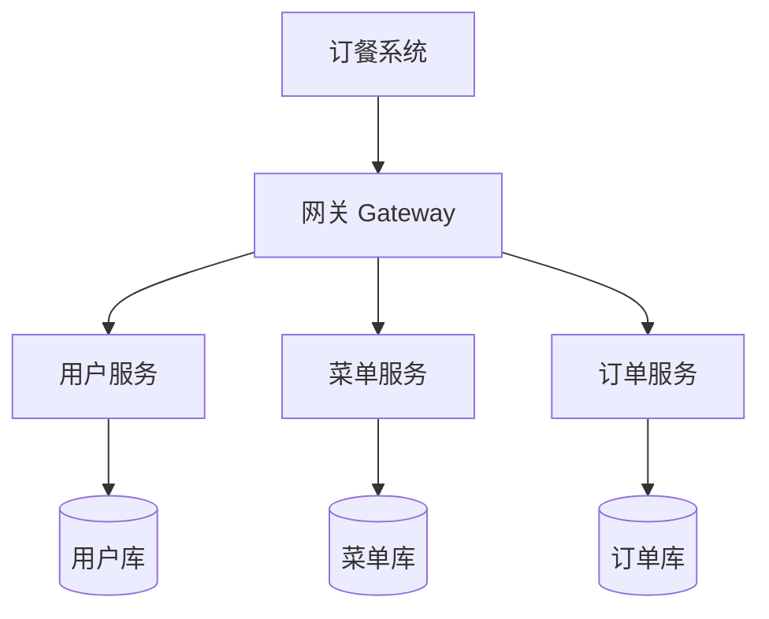

# microservices-practice-2412190221

《微服务开发与实践》课程个人练习仓库。**项目主题：订餐系统** —— 以"用户-菜单-订单"的点餐核心链路为载体，按课程进度完成需求分析、单体实现、微服务拆分、测试与部署。

## 课程信息

- **课程名称**：微服务开发与实践
- **姓名**：金正宇
- **学号**：2412190221

## 项目简介

一个简单的订餐系统，核心只有三个业务模块：**用户、餐厅菜单、订单**。从单体应用起步，后续按业务边界拆分为三个独立服务，作为课程实践作业的载体。

## 技术栈

| 类别 | 选型 |
|------|------|
| 语言 | Java 25（OpenJDK 25 LTS） |
| 框架 | Spring Boot 4.0.x（Spring MVC + Spring Boot Actuator） |
| 构建 | Maven 3.9（项目内置 Maven Wrapper，`./mvnw`） |
| 配置 | `application.yml`（统一配置入口） |
| 测试 | JUnit 5 + Spring Boot Test（MockMvc） |
| 包名 | `com.zjgsu.jzy`（Group / Package name 按课程要求设置） |

## 运行环境要求

| 工具 | 要求 |
|------|------|
| Java | OpenJDK 25（LTS） |
| Maven | 3.9 及以上（也可直接使用项目内置 `./mvnw`） |

## 快速开始（在 monolith/ 目录内执行）

```bash
cd monolith

# 1. 编译并运行全部测试
./mvnw test

# 2. 启动应用（开发模式，监听 8080）
./mvnw spring-boot:run

# 3. 或先打包再运行
./mvnw package
java -jar target/food-ordering-0.0.1-SNAPSHOT.jar
```

> Windows 下将 `./mvnw` 替换为 `.\mvnw.cmd`。应用默认端口 **8080**（见 `monolith/src/main/resources/application.yml`）。

## 当前接口

### 基础接口

| 接口 | 地址 | 说明 |
|------|------|------|
| 问候接口 | `GET http://localhost:8080/hello` | 返回欢迎问候语，验证服务可访问 |
| 健康检查 | `GET http://localhost:8080/actuator/health` | 返回 `{"status":"UP"}`，验证应用运行状态 |

### 订餐业务接口（第 04 周大作业）

| 方法 | 路径 | 说明 |
|---|---|---|
| POST | `/api/food/dishes` | 创建菜品 |
| GET | `/api/food/dishes` | 查询所有菜品 |
| GET | `/api/food/dishes/{id}` | 按 ID 查询菜品 |
| POST | `/api/food/orders` | 下单（总价由后端累加） |
| GET | `/api/food/orders` | 查询所有订单 |
| GET | `/api/food/orders/{id}` | 按 ID 查询订单 |
| POST | `/api/food/orders/{id}/confirm` | 确认订单（仅 PENDING） |
| POST | `/api/food/orders/{id}/complete` | 完成订单（仅 CONFIRMED） |
| DELETE | `/api/food/orders/{id}` | 取消订单（仅 PENDING） |

### 选课接口（第 04 周课内实践）

| 方法 | 路径 | 说明 |
|---|---|---|
| POST | `/api/courses` | 创建课程 |
| GET | `/api/courses` | 查询所有课程 |
| POST | `/api/students` | 创建学生 |
| POST | `/api/enrollments` | 选课 |
| GET | `/api/enrollments/student/{studentId}` | 查询学生选课记录 |
| DELETE | `/api/enrollments/{id}` | 退课 |

## 第 04 周：单体应用与数据库持久化

订餐系统的业务建模见 [docs/project-proposal.md](docs/project-proposal.md)，数据库设计见 [docs/database.md](docs/database.md)，本周记录见 [docs/homework/week-04/](docs/homework/week-04/)。

### 启动命令

```bash
cd monolith
./mvnw spring-boot:run        # 启动应用，监听 8080
```

### 可直接运行的 curl 示例

```bash
# 1. 创建菜品 → 201
curl -i -X POST http://localhost:8080/api/food/dishes \
  -H "Content-Type: application/json" \
  -d '{"name":"宫保鸡丁","category":"川菜","price":28.00,"available":true}'

# 2. 下单（2 份麻婆豆腐，总价 44.00 由后端计算）→ 201
curl -i -X POST http://localhost:8080/api/food/orders \
  -H "Content-Type: application/json" \
  -d '{"customerName":"张三","items":[{"dishId":"<菜品ID>","quantity":2}]}'

# 3. 查询菜品列表 → 200
curl http://localhost:8080/api/food/dishes

# 4. 取消订单 → 204
curl -i -X DELETE http://localhost:8080/api/food/orders/<订单ID>
```

> `<菜品ID>` / `<订单ID>` 为创建接口返回的 id（UUID）。

### 本地 MySQL 安装与连接配置

1. 安装 MySQL 8（Windows 可下载 MySQL Installer 或使用 `docker run -d -p 3306:3306 -e MYSQL_ROOT_PASSWORD=root -e MYSQL_DATABASE=course mysql:8.0`）。
2. 建库与用户（或直接使用 root）：

   ```bash
   mysql -u root -p -e "CREATE DATABASE IF NOT EXISTS course;
   CREATE USER IF NOT EXISTS 'course'@'localhost' IDENTIFIED BY '';
   GRANT ALL PRIVILEGES ON course.* TO 'course'@'localhost';
   FLUSH PRIVILEGES;"
   ```

3. 应用默认连接 `jdbc:mysql://localhost:3306/course`（用户名 `course`，密码为空，见 `monolith/src/main/resources/application.yml`）。如需自定义，用环境变量覆盖：

   ```bash
   set DB_URL=jdbc:mysql://localhost:3306/course
   set DB_USER=course
   set DB_PASSWORD=
   ```

4. 表由 JPA 自动创建（`ddl-auto: update`），启动时 `data.sql` 幂等导入示例菜品（`INSERT IGNORE`，可重复运行）。

### 测试

```bash
cd monolith
./mvnw test
```

测试使用 H2 内存库（`create-drop`），自动准备数据并重复通过。结果：`Tests run: 27, Failures: 0, Errors: 0, Skipped: 0 — BUILD SUCCESS`。

## 第 05 周：Docker 容器化

将订餐单体应用与 MySQL 容器化（多阶段构建 + Compose 一键编排），本周记录见 [docs/homework/week-05/](docs/homework/week-05/)。

### 配置模板复制

```bash
cp .env.example .env     # Windows: copy .env.example .env
# .env 已加入 .gitignore，不会提交真实密码
```

### 构建镜像（仓库根目录）

```bash
docker build -t food-ordering:week05 ./monolith
docker images | grep food-ordering
```

### 启动与查看状态

```bash
docker compose up -d --build   # 一键构建并后台启动 app + mysql
docker compose ps              # 查看两个服务状态（均应为 running）
docker compose logs app        # 查看应用日志
```

### 停止

```bash
docker compose down            # 停止并移除容器（保留数据卷，数据不丢）
docker compose down -v         # ⚠️ 慎用：删除数据卷，会清空所有数据
```

### 健康接口与业务 API 请求示例

```bash
# 健康检查
curl -i http://localhost:8080/actuator/health

# 创建菜品（创建业务数据）→ 201
curl -i -X POST http://localhost:8080/api/food/dishes \
  -H "Content-Type: application/json" \
  -d '{"name":"宫保鸡丁","category":"川菜","price":28.00,"available":true}'

# 查询菜品列表 → 200
curl http://localhost:8080/api/food/dishes

# 下单（总价由后端累加）→ 201
curl -i -X POST http://localhost:8080/api/food/orders \
  -H "Content-Type: application/json" \
  -d '{"customerName":"张三","items":[{"dishId":"<菜品ID>","quantity":2}]}'

# 查询订单 → 200
curl http://localhost:8080/api/food/orders
```

> 数据持久化验证：创建数据后执行 `docker compose down`（不带 `-v`）再 `docker compose up -d`，重新查询同一条记录，确认 id 与关键字段不变。

## 已实现的业务能力

- ✅ 订餐：菜品创建与查询、下单（含菜品存在/可售校验、总价后端累加）、订单状态流转（确认/完成/取消）
- ✅ 选课（第 04 周课内实践）：课程/学生/选课记录管理，含重复选课、满员等业务规则
- ⏳ 用户注册登录与用户信息管理（后续周次实现）

## 用户角色

| 角色 | 说明 |
|------|------|
| 顾客 | 注册登录、浏览菜单、下单、查看自己的订单 |
| 商家 | 维护菜单菜品、查看订单、接单/完成订单 |

## 功能模块

| 模块 | 职责 |
|------|------|
| 用户模块 | 注册、登录、用户信息管理 |
| 菜单模块 | 菜品列表、菜品详情、商家维护菜品 |
| 订单模块 | 创建订单、订单列表、订单状态更新（接单/完成） |

## 核心业务流程


## 功能结构



## 演进方向

| 阶段 | 目标 |
|------|------|
| 阶段一 | 单体应用，先跑通用户-菜单-订单闭环 |
| 阶段二 | 拆分为用户服务、菜单服务、订单服务三个微服务 |
| 阶段三 | Docker 容器化部署 |

> 先做单体降低复杂度，跑通业务后再按业务边界拆分，风险可控。

## 项目范围

**当前范围**：实现顾客注册登录、菜单浏览与维护、下单与订单状态流转（接单/完成）三个核心模块的单体版本。

**暂不实现**：支付对接、配送跟踪、优惠活动、评价体系、多门店管理。

## 后续可扩展方向

| 方向 | 说明 |
|------|------|
| 认证 | 引入 JWT/OAuth2 统一鉴权 |
| 服务拆分 | 按用户/菜单/订单边界拆分为独立微服务 |
| 消息 | 引入消息队列处理下单通知、订单状态事件 |
| 事务 | 分布式事务（订单与库存一致性） |
| 监控 | 链路追踪、日志聚合、指标监控 |
| 部署 | Docker 容器化 + Compose 编排 + CI/CD |

## 目录结构

```
.
├── README.md
├── compose.yaml                 # Docker Compose 编排（app + mysql，第 05 周）
├── .env.example                 # 环境变量模板（复制为 .env，勿提交真实密码）
├── docs/
│   ├── database.md                # 数据库设计文档（订餐系统）
│   ├── project-proposal.md        # 课程项目选题（订餐系统）
│   └── homework/
│       ├── week-01/              # 开发环境与个人仓库
│       ├── week-02/              # Java 基础与项目规划
│       ├── week-03/              # Spring Boot 基础
│       ├── week-04/              # 单体应用与数据库持久化（大作业）
│       │   ├── index.md
│       │   └── screenshots/
│       └── week-05/              # Docker 容器化（大作业）
│           ├── index.md
│           └── screenshots/
├── src/                          # 根目录占位（项目代码位于 monolith/）
│   └── .gitkeep
└── monolith/                     # Spring Boot 单体应用（后续拆分微服务的起点）
    ├── pom.xml                   # Maven 项目配置
    ├── Dockerfile                # 多阶段构建（第 05 周）
    ├── .dockerignore             # 构建上下文忽略规则（第 05 周）
    ├── mvnw / mvnw.cmd / .mvn/   # Maven Wrapper
    └── src/
        ├── main/
        │   ├── java/com/zjgsu/jzy/
        │   │   ├── FoodOrderingApplication       # 应用主类
        │   │   ├── controller/                   # 选课课内实践接口
        │   │   ├── service/ repository/ model/ dto/ exception/
        │   │   └── food/                         # 订餐系统（第 04 周大作业）
        │   │       ├── model/                    # Dish / Order / OrderItem / OrderStatus
        │   │       ├── repository/               # DishRepository / OrderRepository
        │   │       ├── service/                  # DishService / OrderService（业务规则）
        │   │       ├── controller/               # DishController / OrderController
        │   │       └── dto/                      # DishRequest / OrderRequest
        │   └── resources/
        │       ├── application.yml               # 统一配置
        │       └── data.sql                      # 种子数据（INSERT IGNORE 幂等）
        └── test/java/com/zjgsu/jzy/               # 测试代码（含 food/ 下的订餐测试）
```

## 环境信息

| 工具 | 版本 |
|------|------|
| Java | OpenJDK 25 LTS |
| Maven | 3.9（Maven Wrapper） |
| Git | 2.52.0.windows.1 |
| Docker | 29.8.0（Docker Desktop） |
| Docker Compose | v5.5.1 |

> 每周作业详情见 [docs/homework/](docs/homework/) 对应目录。
