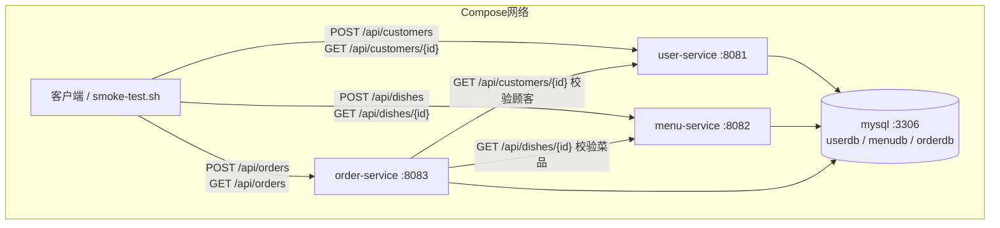

# Week 06 大作业：微服务拆分

- **项目主题**：订餐系统（Food Ordering System）
- **GitHub 仓库**：https://github.com/XXkingzyy/microservices-practice-2412190221
- **实现范围**：在保留 `monolith/` 单体版本的基础上，将订餐系统按业务边界拆分为 **user-service / menu-service / order-service** 三个微服务（各自独立数据库），并完成 Compose 编排、跨服务 RestTemplate 调用、验证脚本与设计文档
- **关键文件**：`services/`（三个服务）、`db/init.sql`、根目录 `compose.yaml`、`scripts/smoke-test.sh`、`docs/microservices-design.md`

---

## 一、服务拆分设计（30%）

详细设计见 [docs/microservices-design.md](../microservices-design.md)，要点如下。

### 拆分动机

原 `monolith/` 把菜品、订单、顾客（待实现）集中在同一个进程与同一个数据库里，任何改动都要重新构建整个应用。按**业务能力边界**拆分后，菜品（menu）、订单（order）、顾客（user）各自独立部署、独立扩展、独立数据库，互不阻塞发布节奏。

### 单体模块 → 微服务映射

| 单体（monolith）模块 | 归属微服务 | 拆分说明 |
|---|---|---|
| `food.model.Dish` / `DishService` / `DishController` | **menu-service**（8082） | 菜品整包迁移，独立 `menudb` |
| `food.model.Order` / `OrderItem` / `OrderService` / `OrderController` | **order-service**（8083） | 原"下单时查库校验菜品"改为跨服务调用校验；新增顾客校验 |
| 顾客（原单体未实现） | **user-service**（8081） | 新增顾客注册与查询，作为下单校验的依赖方 |
| 选课（`model.Course` 等，第 04 周课内实践） | 保留在 `monolith/` | 与订餐大作业物理隔离 |

### 数据所有权与跨库边界

三个服务各建独立库（同一 MySQL 实例内 `userdb` / `menudb` / `orderdb`）、独立账号（`user` / `menu` / `order_user`）。订单表**不建跨库外键**，只保存 `customerId` + `customerName` 快照，明细只保存 `dishId` + `dishName` / `unitPrice` 快照，跨服务信息一律通过 HTTP 获取。

### 服务间调用关系

| 调用方 | 被调用方 | 调用场景 | 失败处理 |
|---|---|---|---|
| `order-service` | `user-service` | 下单前 `GET /api/customers/{id}` 校验顾客 | 404 / 503 |
| `order-service` | `menu-service` | 下单前逐项 `GET /api/dishes/{id}` 校验菜品 | 404 / 409（不可售）/ 503 |



---

## 二、微服务代码（30%）

### 目录结构

```
services/
├── user-service/        # 8081：顾客注册/查询，独立 userdb
│   └── src/main/java/com/zjgsu/jzy/
│       ├── model/Customer.java          # customers 表（id/name/phone/createdAt）
│       ├── repository/CustomerRepository.java
│       ├── service/CustomerService.java
│       ├── controller/CustomerController.java  # POST /api/customers, GET /{id}, GET
│       └── exception/                   # NotFoundException + GlobalExceptionHandler(404/400)
├── menu-service/        # 8082：菜品新增/查询，独立 menudb
│   └── src/main/java/com/zjgsu/jzy/
│       ├── model/Dish.java              # dishes 表（id/name/category/price/available）
│       ├── repository/DishRepository.java
│       ├── service/DishService.java
│       ├── controller/DishController.java    # POST /api/dishes, GET /{id}, GET
│       └── exception/
└── order-service/       # 8083：订单 + 跨服务校验，独立 orderdb
    └── src/main/java/com/zjgsu/jzy/
        ├── model/Order.java / OrderItem.java / OrderStatus.java
        ├── repository/OrderRepository.java
        ├── client/UserServiceClient.java   # GET /api/customers/{id} → 404/503
        ├── client/DishServiceClient.java   # GET /api/dishes/{id} → 404/409/503
        ├── config/AppConfig.java           # RestTemplate + 连接/读取超时
        ├── service/OrderService.java       # 下单前跨服务校验，失败不写入
        ├── controller/OrderController.java # POST /api/orders, GET, confirm/complete/delete
        └── exception/                      # 404 / 409 / 503 / 400 统一映射
```

### 跨服务调用与超时配置

`order-service` 通过 `RestTemplate` 在**下单前**调用 `user-service` 与 `menu-service` 校验顾客、菜品，任一校验失败都返回明确错误码且**不写入本地数据**：

- `config/AppConfig.java`：`SimpleClientHttpRequestFactory` 配置**连接超时 2s、读取超时 3s**（`service.timeout.connect-ms` / `service.timeout.read-ms`，可通过环境变量覆盖）
- `client/UserServiceClient.java`：404 → `NotFoundException("顾客不存在")`；连接失败/超时 → `ServiceUnavailableException`（503）
- `client/DishServiceClient.java`：404 → `NotFoundException("菜品不存在")`；不可售 → `ConflictException`（409）；连接失败/超时 → 503

### 环境变量覆盖服务地址

`order-service/src/main/resources/application.yml` 中地址支持环境变量覆盖，Compose 内以服务名互联：

```yaml
service:
  user-service:
    url: ${USER_SERVICE_URL:http://localhost:8081}
  menu-service:
    url: ${MENU_SERVICE_URL:http://localhost:8082}
```

### 单元测试

每个服务均带 `src/test/java` 测试（H2 内存库）：

- `UserServiceApiTest` / `MenuServiceApiTest`：MockMvc 覆盖 201 / 200 / 404 / 400
- `OrderServiceTest`：Mockito 覆盖成功下单（总价 56.00）、菜品不存在 404 且不写库、菜品不可售 409、用户服务不可用 503

---

## 三、Compose 编排（20%）

根目录 `compose.yaml` 一键编排 1 个 MySQL 实例 + 3 个微服务：

| 服务 | 构建 | 端口 | 数据库/账号 | 依赖 |
|---|---|---|---|---|
| mysql | `mysql:8.4.11` | 3306 | root | healthcheck：`mysqladmin ping` |
| user-service | `./services/user-service` | 8081 | `userdb` / `user` / `user123` | mysql healthy |
| menu-service | `./services/menu-service` | 8082 | `menudb` / `menu` / `menu123` | mysql healthy |
| order-service | `./services/order-service` | 8083 | `orderdb` / `order_user` / `order123` | mysql healthy |

- `db/init.sql`：首次启动时创建三个独立数据库与账号并授权（`docker-entrypoint-initdb.d` 挂载）
- 环境变量：`USER_SERVICE_URL=http://user-service:8081`、`MENU_SERVICE_URL=http://menu-service:8082`，以 Compose 服务名互联（不使用 localhost）
- `.env.example` 提供 `MYSQL_ROOT_PASSWORD` 模板；命名数据卷 `mysql-data` 持久化

```bash
docker compose up -d
docker compose ps
```

---

## 四、验证脚本（10%）

`scripts/smoke-test.sh`（从仓库根目录运行）覆盖：

| 场景 | 预期 |
|---|---|
| 三服务健康检查（轮询 `/actuator/health`，60s 超时） | 200 |
| 注册顾客 → 201 | 201 |
| 新增菜品 → 201 | 201 |
| 跨服务下单（校验顾客 + 菜品）→ 201 | 201 |
| 查询订单（总价 28.00 × 2 = 56.00）→ 200 | 200 |
| 菜品不存在下单 → 404（不写入） | 404 |
| 顾客不存在下单 → 404 | 404 |
| 菜品已下架（available:false）下单 → 409 | 409 |
| 停掉 menu-service 后下单 → 503，再恢复服务 | 503 |

运行方式：

```bash
bash scripts/smoke-test.sh
```

---

## 五、文档与截图（10%）

截图见 `screenshots/`：

- `01-images.png`：`docker images` 三个微服务镜像构建成功
- `02-compose-up.png`：`docker compose up -d` + `docker compose ps` 全部 running
- `03-health.png`：三个服务 `/actuator/health` 均 200 UP
- `04-flow.png`：跨服务业务流程（注册顾客 → 新增菜品 → 下单 → 查询订单）
- `05-fail.png`：失败场景 404 / 404 / 409
- `06-503.png`：依赖服务不可用 → 503，恢复后正常
- `07-smoke.png`：`smoke-test.sh` 全绿汇总（PASS=n FAIL=0）
- `08-code.png`：`services/` 代码目录与关键文件

---

## 课内实践说明

第 06 周课内实践（选课系统单体中拆出独立服务 `course-service`，座位号 **40**）：独立 Spring Boot 项目，H2 内存库（`MODE=MySQL`）自包含，端口 8090，`POST /api/courses` 创建课程（含重复 code 409 校验）、`GET /api/courses` 查询。运行截图见 `screenshots/`：`09-course-run.png`（容器启动 + 健康检查 + 创建/查询课程）、`10-course-ps.png`（`docker ps`）。按课堂要求直接提交至作业系统。
