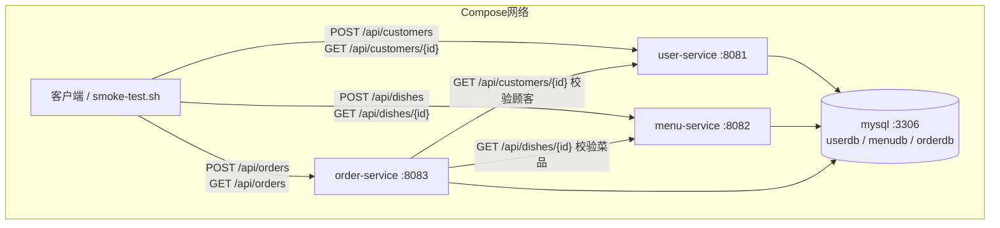

# 微服务拆分设计（第 06 周大作业）

> 项目主题：订餐系统（Food Ordering System）
> 拆分目标：在保留 `monolith/` 单体版本的基础上，将订餐业务按业务边界拆分为 **user-service、menu-service、order-service** 三个微服务。

---

## 一、拆分动机与原则

- **按业务能力拆分，不按技术层拆分**：避免把同一业务能力切散成 Controller/Service/Repository 跨服务高频调用。
- **每个服务只读写自己的数据**：跨服务信息一律通过 HTTP API 获取，只保存对方的 ID 作为跨服务关联，不建立跨库外键、不直接调用对方的 Repository。
- **本地验证优先**：Compose 一键启动全部服务与数据库，`scripts/smoke-test.sh` 覆盖健康检查、跨服务成功流程与失败场景。

## 二、单体模块 → 微服务拆分映射

| 单体（monolith）模块 | 归属微服务 | 拆分说明 |
|---|---|---|
| `food.model.Dish` / `DishService` / `DishController` | **menu-service** | 菜品是菜单服务的独立数据，整包迁移 |
| `food.model.Order` / `OrderItem` / `OrderService` / `OrderController` | **order-service** | 订单独立；原单体中"下单时查库校验菜品"改为"调用 menu-service API 校验"，并新增"调用 user-service API 校验顾客" |
| 顾客（原单体未实现，README 列为后续周次） | **user-service** | 新增用户模块：顾客注册与查询，作为订单跨服务校验的依赖方 |
| 选课课内实践（`model.Course` 等，第 04 周课内实践） | 保留在 `monolith/` | 与订餐大作业物理隔离，不参与本次拆分 |

## 三、三个微服务的职责、端口、数据库与数据表

| 服务 | 端口 | 职责 | 独立数据库（同一 MySQL 实例内） | 数据表 | 独立账号 |
|---|---|---|---|---|---|
| `user-service` | 8081 | 顾客注册、查询；为下单提供顾客校验 | `userdb` | `customers` | `user` / `user123` |
| `menu-service` | 8082 | 菜品新增、查询；为下单提供菜品校验 | `menudb` | `dishes` | `menu` / `menu123` |
| `order-service` | 8083 | 订单创建与状态流转；跨服务校验顾客与菜品 | `orderdb` | `food_orders`、`food_order_items` | `order_user` / `order123` |

- 三个库共用同一 MySQL 实例（`mysql:8.4.11`），由 `db/init.sql` 在首次启动时创建独立数据库与账号，`compose.yaml` 为每个服务注入各自的 `DB_URL/DB_USER/DB_PASSWORD`。
- 数据卷 `mysql-data` 持久化数据，容器重建不丢数据。

## 四、数据所有权与跨服务关联

- **user-service**：拥有 `customers` 表。
- **menu-service**：拥有 `dishes` 表。
- **order-service**：拥有 `food_orders`、`food_order_items` 表。
  - 订单只保存 `customerId`（顾客 ID）与 `customerName`（下单时快照）；
  - 明细只保存 `dishId`（菜品 ID）与 `dishName`、`unitPrice`（下单时快照）。
  - **不建立跨库外键、不直接访问 userdb/menudb 的表**，顾客姓名与菜品名称/单价均来自跨服务 HTTP 调用结果。

## 五、服务间调用关系

| 调用方 | 被调用方 | 调用场景 | 返回 | 失败处理 |
|---|---|---|---|---|
| `order-service` | `user-service` | `GET /api/customers/{id}` 下单前校验顾客 | 顾客信息（姓名快照） | 404 → 下单拒绝；连接失败/超时 → 503 |
| `order-service` | `menu-service` | `GET /api/dishes/{id}` 下单前逐项校验菜品 | 菜品信息（名称/单价/可售） | 404 → 下单拒绝；不可售 → 409；连接失败/超时 → 503 |

- 服务地址写入 `order-service` 的 `application.yml`（`service.user-service.url`、`service.menu-service.url`），Compose 中通过环境变量 `USER_SERVICE_URL`、`MENU_SERVICE_URL` 覆盖为容器间服务名。
- RestTemplate 配置了连接超时（2s）与读取超时（3s），见 `services/order-service/src/main/java/com/zjgsu/jzy/config/AppConfig.java`。
- 任一校验失败都返回明确错误（404/409/503），**不跳过校验写入本地数据**。

## 六、架构图



## 七、目录结构

```
services/
├── user-service/        # 8081，顾客（customers）
├── menu-service/        # 8082，菜品（dishes）
└── order-service/       # 8083，订单 + 跨服务校验（food_orders, food_order_items）
db/init.sql              # 创建三个独立数据库与账号
compose.yaml             # 一键启动 mysql + 三个服务
scripts/smoke-test.sh    # 健康检查 + 跨服务流程 + 失败场景验证
```

## 八、运行与验证

```bash
docker compose up -d --build   # 一键启动 mysql + 三个微服务
bash scripts/smoke-test.sh     # 健康检查 + 跨服务下单成功 + 失败场景
```

## 第 07 周演进

保留上述业务边界与数据归属。order-service 删除固定 service.*.url 配置，每次校验通过 DiscoveryClient 寻址 user-service/menu-service 后发起 HTTP 调用。Nacos 地址及鉴权从 NACOS_SERVER_ADDR、NACOS_USERNAME、NACOS_PASSWORD、NACOS_NAMESPACE 读取，个人分组 PERSONAL_GROUP。连接和读取超时保持 2s/3s。空实例为 503。控制台 18080、服务 8848、SDK 9848。上述第 6 周固定地址说明属于历史设计。
